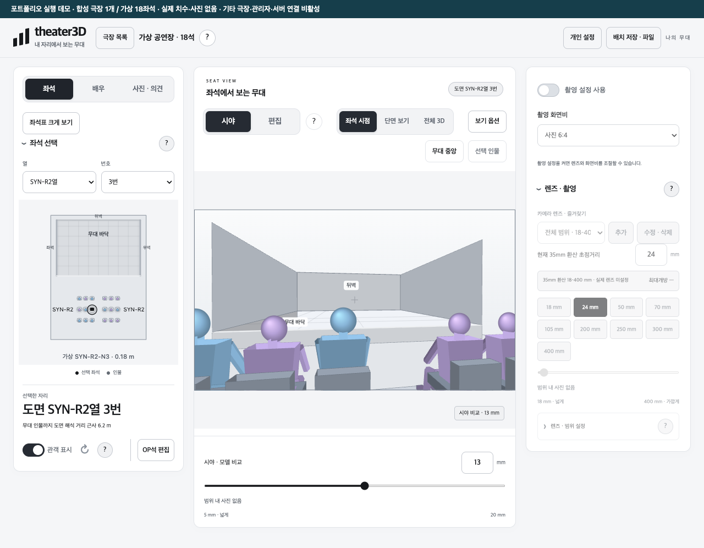
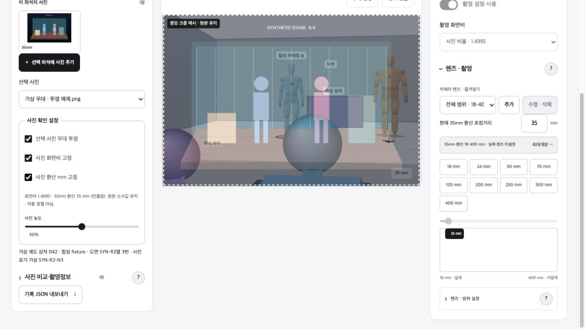

# theater3D

**내 자리에서 보는 무대** — 좌석에 따른 시야와 무대 배치를 함께 비교하는 개인 프로젝트입니다.

좌석의 방향·단차·앞사람과 무대 위 인물이 어떻게 겹치는지 살펴보고, 사진과 가상의 배치를 비교하려고 만들었습니다. 이 저장소는 제품의 화면과 조작을 체험할 수 있도록 **가상 공연장 1개, 18좌석**으로 구성한 포트폴리오 데모입니다.

[웹 데모](https://si-planet.github.io/theater3d-portfolio/) · [공개 소스](https://github.com/si-planet/theater3d-portfolio) · [실행·게시 방법](PUBLISH.md) · [검증 범위](QA_REPORT.json)



화면의 극장·인물·배치는 합성 예제입니다. 실제 극장의 좌석이나 공연 사진을 재현한 자료가 아닙니다.

## 체험할 수 있는 기능

| 기능 | 확인할 내용 |
| --- | --- |
| 좌석 선택 | 18개 좌석을 바꾸며 시점과 앞좌석의 영향을 비교 |
| 보기 전환 | 좌석 시점, 시야 단면, 전체 3D를 전환 |
| 무대 편집 | 인물·구조물을 추가하고 위치·크기·배치를 조정 |
| 촬영 비교 | 초점거리와 화면 비율에 따라 인물이 담기는 범위를 확인 |
| 사진 비교 | 기본 좌석의 합성 예제와 로컬 사진을 무대에 겹쳐 보고 농도·화면비·초점거리를 조절 |
| 좌석 의견 체험 | 선택 좌석의 메모를 브라우저에 저장·조회·삭제 |
| 배치 보관 | 브라우저 저장, 배치 JSON 내보내기·불러오기 |

극장 목록에는 예제 극장만 열 수 있습니다. 다른 공연장은 비활성 항목으로 표시합니다. 로그인, 공개 사진·의견의 서버 등록, 관리자 기능, 실제 극장 데이터 조회는 데모에 연결하지 않았습니다.

## 사용 순서

1. 인물 2명과 구조물 2개가 배치된 기본 좌석에서 시작합니다.
2. 좌석표에서 다른 자리를 선택하고 **좌석 시점 → 시야 단면 → 전체 3D**를 비교합니다.
3. 편집 모드에서 인물과 무대 객체의 위치·크기를 바꿉니다.
4. 시야 모드로 돌아와 촬영 설정의 초점거리와 가로·세로 화면을 비교합니다.
5. 기본 좌석 **가상 SYN-R2-N3**의 합성 사진을 선택해 무대 투영·농도·화면비 고정·환산 초점거리 고정을 비교합니다. 다른 사진은 원하는 좌석에서 로컬 파일로 열 수 있습니다.
6. **좌석 의견 체험**에서 메모를 작성하고 저장·삭제합니다. 이 내용은 해당 브라우저에만 남습니다.
7. 마음에 드는 배치를 브라우저에 저장하거나 JSON 파일로 내보냅니다.

합성 사진은 Canvas로 생성한 1620×1080(6:4) 이미지입니다. 환산 35mm는 체험용 입력값이며 실제 촬영정보가 아닙니다. 로컬 표시본은 기존 처리 정책에 따라 1600×1067로 변환됩니다. 운영 서비스의 FHD 업로드 검증과 구분하며, 무대와 사진은 수동 비교용으로 정밀 정합을 보장하지 않습니다.



사진을 열어도 서버로 전송하지 않습니다. **브라우저 보관**을 명시적으로 선택한 사진만 이 사이트의 IndexedDB에 남습니다. 배치·렌즈·메모는 `theater3d-portfolio.*` 저장소를 사용하며 다른 기기와 동기화하지 않습니다. 브라우저 데이터 삭제 시 보관본도 사라질 수 있으므로 필요한 배치는 파일로 내보내세요.

사진을 정리하는 두 동작은 적용 범위가 다릅니다.

| 동작 | 적용 범위 |
| --- | --- |
| 현재 목록에서 빼기 | 현재 페이지의 사진 목록에서만 제거합니다. 이미 저장한 브라우저 보관본은 남아 있어 재접속하면 복원됩니다. |
| 보관본 삭제 | 사진 이름과 삭제 범위를 화면 안에서 확인한 뒤, 선택한 사진의 브라우저 보관본만 삭제합니다. 현재 페이지에 열린 이미지와 다른 사진은 유지됩니다. |

삭제 확인에서 **취소**하거나 `Esc`를 누르면 보관본을 유지합니다. 확인 도중 다른 사진·좌석으로 이동하면 이전 삭제 확인은 해제됩니다. 두 동작 모두 컴퓨터나 휴대폰에서 선택한 원본 파일을 지우지 않습니다. 기본 합성 사진은 데모 시작 시 다시 생성되는 예제이므로 사용자 파일의 보관 여부와 별개입니다.

## 구현 구조

프레임워크나 외부 3D 엔진 없이 JavaScript ES 모듈과 Canvas API로 구성했습니다. HTML·CSS·JS·JSON을 정적 호스트에서 제공하며, 실행에 API 키나 환경변수가 필요하지 않습니다.

```text
가상 극장 JSON
  → 극장·좌석 모델 읽기
  → 좌석 위치 / 카메라 / 무대 배치 계산
  → Canvas: 좌석 시점 · 단면 · 전체 3D

사용자 조작
  → 화면 상태 갱신
  → 브라우저 저장 또는 배치 JSON 내보내기
```

| 구성 | 역할 |
| --- | --- |
| `data/demo/` | 독립적으로 작성한 가상 극장의 형상·좌석 데이터 |
| `src/geometry.js`, `src/stage-layout.js` | 좌석 좌표와 인물·구조물 배치 계산 |
| `src/scene.js`, `src/sight-section.js` | 좌석 시점·전체 3D·단면 렌더링 |
| `src/photos.js`, `src/photo-asset-processing.js` | 로컬 이미지와 촬영정보 처리 |
| `src/simulation-storage.js`, `src/local-photo-store.js` | 배치·사진의 브라우저 보관 |
| `tests/` | 합성 모델, 공개 범위와 정적 경로 검사 |

극장 데이터와 화면 상태를 분리해 같은 렌더러로 다른 배치를 표현할 수 있게 했습니다. 사진은 선택한 극장·모델·좌석에 연결하므로 자리를 옮겼을 때 다른 좌석의 사진이 섞이지 않도록 구성했습니다.

## 개발 과정

사용자가 기능 요구와 화면 배치, 좌석·사진의 연결 규칙을 정하고 직접 검토했습니다. AI는 구현, 자료 정리와 검증을 지원했습니다. 화면 확인에서 나온 피드백을 바탕으로 보기와 편집의 역할을 분리하고, 사진 투영 제어·정수 초점거리·배치 보관 등 조작 흐름을 보완했습니다.

공개본을 만들 때는 제품의 화면·계산 코드를 대조하면서 실제 자료와 서버 연결을 걷어내고 합성 데이터로 교체했습니다. 운영 서비스의 인증·DB 검증과 이 정적 데모의 검증은 구분해 기록합니다.

## 로컬 실행

Python 3가 있다면 프로젝트 폴더에서 실행합니다. Windows에서는 `python3` 대신 `py -3`를 사용할 수 있습니다.

```sh
python3 -m http.server 8897 --bind 127.0.0.1
```

접속 주소: `http://127.0.0.1:8897/`

별도 설치·빌드는 필요하지 않습니다. ES 모듈과 JSON을 읽으므로 HTML 더블클릭 대신 HTTP 서버를 사용합니다. GitHub Pages에서는 저장소 하위 경로에 그대로 게시할 수 있습니다.

## 검증과 제한

```sh
python3 -B tests/audit-safe-export.py
node tests/synthetic-fixture.mjs
node tests/portfolio-boundaries.mjs
```

Node는 검사할 때만 필요합니다. 실행에는 필요하지 않습니다. 검사 결과와 실제 브라우저 확인 범위는 [QA_REPORT.json](QA_REPORT.json)에 기록합니다.

브라우저에서 합성 사진 조회·투영·화면비 및 환산 초점거리 잠금, 좌석 메모 저장·새로고침 복원·삭제를 확인했습니다. 좁은 화면에서 주요 조작의 가로 넘침은 없었습니다. 내장 브라우저에서는 화면 크기를 바꾼 뒤 전체 페이지 캡처 시 무대가 검게 잡힌 사례가 있었지만, Chrome에서 좁은 화면 → 데스크톱 → 전체 페이지 캡처 → 크기 초기화를 다시 확인했을 때는 무대와 사진이 정상 표시됐습니다. 원인은 확정하지 않았고 이 현상을 이유로 렌더러를 수정하지도 않았습니다. 이 결과는 실휴대폰 전체 검수나 모든 화면 전환의 통과를 뜻하지 않습니다.

2026-11-13에 새 Git 이력으로 공개 저장소와 GitHub Pages에 게시했습니다. 실제 HTTPS 주소에서 합성 사진 투영·좌석 이동·단면/전체 3D·하위 경로 새로고침·의견 저장/복원/삭제를 확인했습니다. 주요 배포 파일 12개는 검수본과 해시가 일치했습니다. 첫 접속에서는 초기 모듈 로딩이 지연되는 사례가 있었고 완료 후 정상 동작했습니다. 실휴대폰 전체 검수와 최초 로딩 성능 개선은 남아 있습니다.

- 형상·시야·인체·카메라는 비교를 위한 근사 표현입니다. 실제 관람 시야나 좌석 품질을 보증하지 않습니다.
- 실제 극장 데이터·사진·도면·계정·인증정보·비공개 Git 이력은 포함하지 않습니다.
- 일부 비활성 클라이언트 모듈은 기존 화면의 의존성을 유지하기 위해 남아 있습니다. 운영 서버 연결 설정은 비활성입니다.
- 정적 검사·모의 Canvas 수치 검사·브라우저 확인·실휴대폰 검수는 서로 다른 검증입니다.
- 저장 키가 구분되어도 같은 호스트의 다른 사이트와 별도 보안 경계가 만들어지는 것은 아닙니다.

## 이용 조건

이 저장소는 **포트폴리오 열람·평가 목적**으로 공개합니다. [LICENSE](LICENSE)는 수정하지 않은 사본의 평가용 실행을 허용하며, 코드·데이터의 일반 재사용이나 재배포를 허용하는 오픈소스 라이선스가 아닙니다. GitHub에서의 열람·fork 등 플랫폼 약관상 권리는 별도로 적용됩니다. [GitHub 라이선스 안내](https://docs.github.com/en/repositories/managing-your-repositorys-settings-and-features/customizing-your-repository/licensing-a-repository)

제3자 참고 링크와 명칭의 범위는 [THIRD_PARTY_NOTICES.md](THIRD_PARTY_NOTICES.md)에 정리했습니다.
